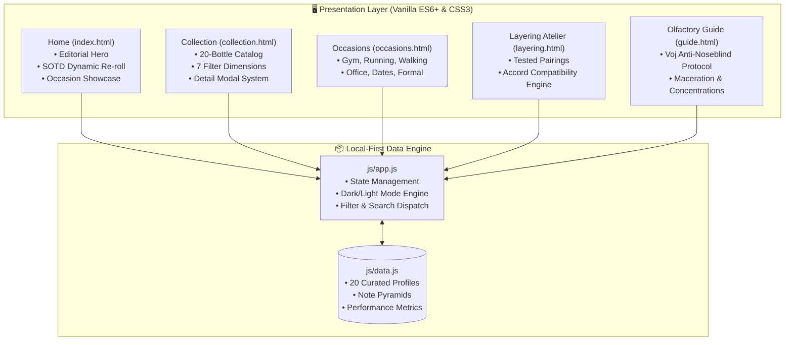

<div align="center">

# 🌿 L'ATELIER OLFACTIF
### *Haute Parfumerie, Interactive Wardrobe & Olfactory Architecture*

[](https://github.com/passportpowell)
[](https://developer.mozilla.org/en-US/docs/Web/JavaScript)
[](https://www.w3.org/TR/css-variables/)
[](https://localfirstweb.com/)
[](LICENSE)

<p align="center">
  <b>A bespoke, high-performance web dashboard showcasing a curated personal collection of 20 artisanal fragrances.</b><br />
  Engineered with zero external framework dependencies, instant client-side filtering, interactive layering chemistry, and audited studio photography.
</p>

</div>

---

## 🏛️ Executive Summary

Most digital perfume showcases are either sluggish e-commerce catalogs or cluttered community forums dominated by unverified user votes and heavy telemetry. 

**L'Atelier Olfactif** is built on five core principles:
1. **Lightweight & Dependency-Free**: Pure semantic HTML5, modern CSS3 with hardware-accelerated transitions, and modular vanilla JavaScript. Zero build-step requirements.
2. **Deterministic Recommendation Engine**: Algorithmic "Scent of the Day" selection based on diurnal cycle, seasonality, and curated versatility scoring.
3. **Olfactory Layering Calculator**: Mathematical accord-matching matrix ranking pairing compatibility across 19 partner bottles with strict spray sequence guidance (heavier base vs. volatile top).
4. **Context-Driven Occasion Architecture**: Tailored collections mapped to real-life settings: Gym & Athletic Workouts, Running, Walking, Executive/Office, Intimate Dates, and Formal Galas.
5. **Audited Asset Accuracy**: Every flacon is documented with verified studio packshots, olfactory note pyramids (top/heart/base), clone provenance (Paris Corner, Escentric Molecules, Tom Ford, Fragrance World), and maturation states.

---

## 🏗️ Architecture & Multi-Page Flow



---

## ✨ Key Feature Modules

### 1. 🔍 Multi-Dimensional Catalog & Detail Modal
* **Instant Faceted Filtering**: Filter across Season (*Winter, Spring, Summer, Autumn*), Time of Day (*Day, Night, Any*), Strength (*EDP, Extrait, Body Spray*), and curated tags.
* **Instant Substring Search**: Real-time matching across perfume names, luxury houses, clone inspirations, and individual scent notes.
* **Full Note Breakdown**: Modal views reveal top, mid, and base notes alongside longevity, projection, and maceration timelines.

### 2. 🧪 Interactive Layering Compatibility Matrix
* Select any primary anchor bottle to dynamically generate compatibility rankings across all 19 partner bottles.
* Provides clear physical spray orders: base anchors (*e.g., Wood Miracle, After Effect*) are applied first, followed by high-volatility molecular enhancers (*e.g., Molecule 01 Iso E Super, Molecule 02 Ambroxan*).

### 3. 🎯 Purpose-Built Occasions
* **Athletic & Gym**: High-heat-tolerant, non-offensive selections (*Citrus Particle, Sweet Water*).
* **Executive & Office**: Clean, woody-aromatic compositions with refined sillage.
* **Evening & Intimate**: Warm ambers, boozy accords, and rich gourmand profiles (*After Effect, Laya*).

### 4. 🌗 Persistent Theme Architecture
* Seamless Light Mode (editorial default) and Dark Mode.
* Zero flicker on page load via `localStorage` state persistence.

---

## 📂 Repository Structure

```
fragrance-dashboard/
├── assets/
│   └── bottles/
│       ├── cropped/         # Audited product crops
│       ├── studio/          # High-resolution studio flacon photography
│       └── user_photos/     # Actual shelf and bottle verification photos
├── css/
│   └── styles.css           # Modern CSS3 design system with custom properties
├── js/
│   ├── app.js               # Core UI logic, modal handling, filter dispatch
│   └── data.js              # Complete 20-bottle database and accord mappings
├── docs/                    # Technical handoff and audit documentation
├── test/
│   └── validate-inventory.js # Data schema and image asset validation script
├── index.html               # Home & Scent of the Day recommendation
├── collection.html          # All Fragrances vault & modal catalog
├── occasions.html           # Contextual occasion collections
├── layering.html            # Layering Atelier and accord calculator
├── guide.html               # Practical curation and application guide
├── vercel.json              # Clean URL routing configuration
└── LICENSE                  # MIT License
```

---

## ⚡ Quickstart & Local Execution

Because this project is built local-first without Node dependencies or compilation steps, you can serve it with any local HTTP server:

### Option 1: Python HTTP Server (Recommended)
```bash
# Clone the repository
git clone https://github.com/passportpowell/fragrance-dashboard.git
cd fragrance-dashboard

# Launch local server
python -m http.server 8000
```
Then navigate to `http://localhost:8000` in your browser.

### Option 2: Node.js (via npx)
```bash
npx serve .
```

### Option 3: Verification Suite
Validate that all 20 bottle profiles, image assets, and note pyramids pass schema validation:
```bash
node test/validate-inventory.js
```

---

## 📜 Provenance & License

- **Curator & Engineer**: [Otis Powell](https://github.com/passportpowell)
- **License**: Released under the [MIT License](LICENSE).
